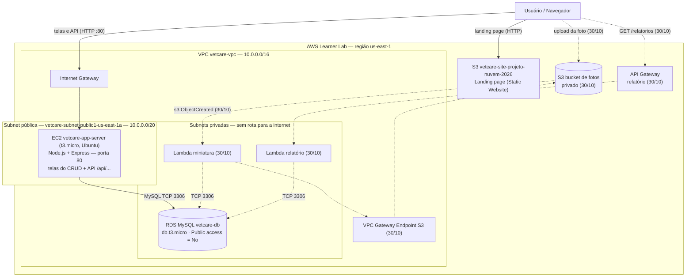
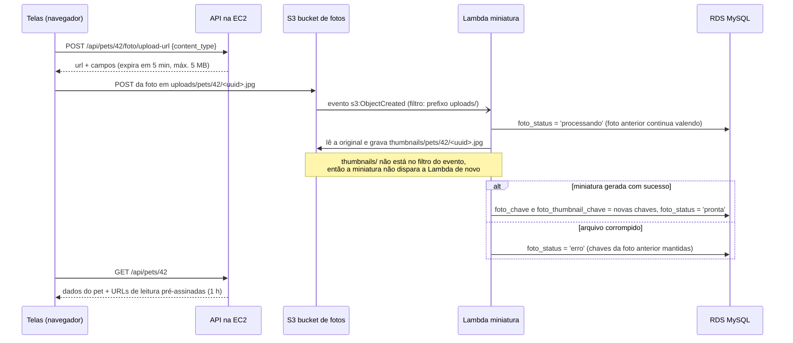
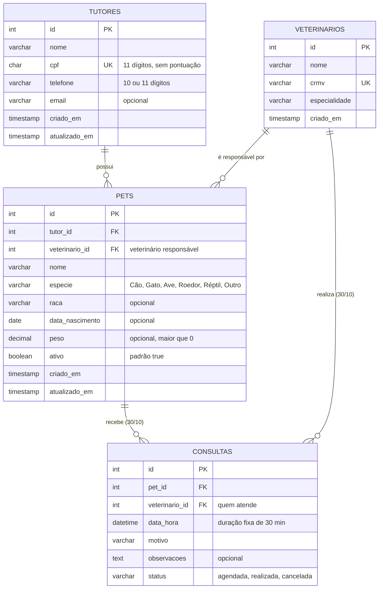

# Arquitetura e Design — VetCare

Este documento descreve **como** o VetCare atende ao que foi especificado no [`spec.md`](./spec.md): o diagrama de arquitetura na AWS, o modelo de dados, as rotas da API, os Security Groups e as decisões de arquitetura (ADRs).

> **Situação em 23/10:** VPC, RDS MySQL privado, EC2 da aplicação e CRUD de tutores e pets (RF-01) estão **implantados e funcionando**. Os itens marcados como **(30/10)** são o planejamento da próxima entrega (upload de fotos, miniaturas, consultas e relatório).

---

## 1. Diagrama de Arquitetura

### 1.1 Visão geral



Linhas contínuas: implantado. Linhas tracejadas: planejado para 30/10.

| Componente | Função | Requisitos | Situação |
| :--- | :--- | :--- | :--- |
| **S3 `vetcare-site-projeto-nuvem-2026`** | Landing page pública do projeto | Entrega 16/10 | ✅ No ar |
| **EC2 `vetcare-app-server`** | Servidor Node.js/Express na subnet pública: entrega as telas do CRUD e a API `/api/...` no mesmo endereço | RF-01, RF-05 (parcial), RNF-03 | ✅ No ar |
| **RDS MySQL `vetcare-db`** | Banco relacional nas subnets privadas, sem acesso público | RF-01, RNF-01 | ✅ No ar |
| **Bucket de fotos + Lambda de miniatura** | Upload via URL pré-assinada gerada pela EC2; a Lambda gera a miniatura e grava no RDS | RF-02, RF-03 | ⏳ 30/10 |
| **API Gateway + Lambda de relatório** | `GET /relatorios/consultas-por-veterinario` com JOIN e GROUP BY | RF-04 | ⏳ 30/10 |
| **VPC Gateway Endpoint (S3)** | Acesso da Lambda de miniatura ao S3 sem internet | RF-03 | ⏳ 30/10 |

### 1.2 Rede

| Recurso | Nome | Configuração |
| :--- | :--- | :--- |
| VPC | `vetcare-vpc` | `10.0.0.0/16` |
| Subnet pública | `vetcare-subnet-public1-us-east-1a` | `10.0.0.0/20` — onde fica a EC2 |
| Subnet privada | `vetcare-subnet-private1-us-east-1a` | `10.0.128.0/20` |
| Subnets privadas do RDS | `RDS-Pvt-subnet-1` a `RDS-Pvt-subnet-5` | `10.0.16.0/25` a `10.0.18.0/25`, em us-east-1a, b, c, e, f. Criadas pelo assistente do RDS ao conectar o banco à EC2; formam o *DB subnet group* |
| Internet Gateway | (criado pelo assistente da VPC) | Associado à `vetcare-vpc` |
| Tabela de rotas pública | `vetcare-rtb-public` | `10.0.0.0/16 → local` · `0.0.0.0/0 → Internet Gateway` |
| Tabelas de rotas privadas | `vetcare-rtb-private1-us-east-1a` e `RDS-Pvt-rt` | somente `10.0.0.0/16 → local` — **sem rota para a internet** |
| NAT Gateway | — | **Não existe** (evita custo no Learner Lab) |

**Como os recursos estão organizados:** a EC2 fica na subnet pública porque precisa receber acessos do navegador (porta 80). O RDS fica nas subnets privadas, que só têm a rota `local`: ele é alcançável apenas de dentro da VPC. A comunicação EC2 → RDS acontece pela rede interna da VPC, na porta 3306, controlada pelos Security Groups (seção 4).

### 1.3 Fluxo de upload da foto e geração da miniatura (30/10)



---

## 2. Modelo Entidade-Relacionamento

### 2.1 Diagrama ER



**Relacionamentos:**
* **Tutor 1:N Pet** — todo pet pertence a exatamente um tutor (RF-01). Implantado.
* **Veterinário 1:N Pet** — todo pet tem um veterinário responsável. Implantado.
* **Pet N:N Veterinário, por meio de Consultas** — planejado para 30/10 (RF-06).

### 2.2 Scripts SQL (MySQL)

O script versionado fica em [`sql/schema.sql`](../sql/schema.sql) e é executado a partir da EC2 (passo 4.8 do README):

| Script | Conteúdo |
| :--- | :--- |
| [`sql/schema.sql`](../sql/schema.sql) | Criação do banco e das tabelas `veterinarios`, `tutores` e `pets` (chaves estrangeiras e restrições `CHECK`) e carga inicial dos 3 veterinários. Em 30/10, as colunas de foto e a tabela `consultas` serão acrescentadas a este mesmo script |

Trecho principal do `schema.sql`:

```sql
CREATE TABLE IF NOT EXISTS pets (
    id              INT AUTO_INCREMENT PRIMARY KEY,
    tutor_id        INT          NOT NULL,
    veterinario_id  INT          NOT NULL,
    nome            VARCHAR(50)  NOT NULL,
    especie         VARCHAR(10)  NOT NULL,
    raca            VARCHAR(50),
    data_nascimento DATE,
    peso            DECIMAL(5,2),
    ativo           BOOLEAN      NOT NULL DEFAULT TRUE,
    CONSTRAINT fk_pets_tutor       FOREIGN KEY (tutor_id)       REFERENCES tutores(id)      ON DELETE RESTRICT,
    CONSTRAINT fk_pets_veterinario FOREIGN KEY (veterinario_id) REFERENCES veterinarios(id) ON DELETE RESTRICT,
    CONSTRAINT chk_pets_especie CHECK (especie IN ('Cão', 'Gato', 'Ave', 'Roedor', 'Réptil', 'Outro')),
    CONSTRAINT chk_pets_peso    CHECK (peso IS NULL OR peso > 0)
);
```

### 2.3 Onde cada regra da spec é garantida

| Regra (spec) | Banco de dados | API (EC2) |
| :--- | :--- | :--- |
| CPF único, com ou sem pontuação (US-01) | `UNIQUE` + CPF gravado só com dígitos | Remove a pontuação e exige 11 dígitos (CPF fictício é aceito); duplicidade → **409** "CPF já cadastrado" |
| Tutor com pets não pode ser excluído (US-01) | `ON DELETE RESTRICT` | Conta os pets antes de excluir → **409** "Tutor possui pets cadastrados" |
| CPF mascarado na listagem (US-01, RNF-06) | — | `GET /api/tutores` devolve `***.456.789-**`; o CPF completo só em `GET /api/tutores/{id}` |
| Espécie válida e peso positivo (US-02) | `CHECK` | Validação antes do `INSERT`/`UPDATE` → **400** |
| Tutor e veterinário existentes (US-02) | `FOREIGN KEY` | Erro de chave estrangeira → **400** "Tutor ou veterinário informado não existe" |
| Pet inativo mantém dados e histórico (US-02) | Coluna `ativo` | `PATCH /api/pets/{id}/situacao`; a listagem padrão mostra só ativos |
| Busca sem diferenciar maiúsculas e acentos (US-03) | Collation `utf8mb4_0900_ai_ci` | `WHERE nome LIKE ?` |
| CPF e telefone fora dos logs (RNF-06) | — | O log registra apenas método, caminho e status |
| Conflito de agenda (US-06, 30/10) | — | Transação com bloqueio da linha do veterinário (ADR-004) |

---

## 3. Rotas da API

**Base:** `http://<IP-público-da-EC2>/api`. As telas são servidas pelo mesmo servidor e chamam a API pelo caminho relativo `/api/...`, sem IP fixo no código (RNF-03).

### 3.1 Implantadas (23/10)

| Método | Rota | Descrição | Sucesso | Erros | Requisito |
| :--- | :--- | :--- | :--- | :--- | :--- |
| `GET` | `/api/health` | Verifica a conexão com o RDS | 200 | 500 | RNF-01 |
| `GET` | `/api/veterinarios` | Lista os veterinários (carga inicial) | 200 | — | RF-01 |
| `GET` | `/api/tutores?busca=` | Lista em ordem alfabética, CPF mascarado, total de pets. `busca` = trecho do nome ou CPF | 200 | — | RF-01, RF-08 |
| `GET` | `/api/tutores/{id}` | Detalhe do tutor, com CPF completo | 200 | 400, 404 | RF-01 |
| `POST` | `/api/tutores` | Cadastra um tutor | 201 | 400, 409 | RF-01 |
| `PUT` | `/api/tutores/{id}` | Edita um tutor | 200 | 400, 404, 409 | RF-01 |
| `DELETE` | `/api/tutores/{id}` | Exclui um tutor sem pets | 204 | 404, 409 | RF-01 |
| `GET` | `/api/tutores/{id}/pets` | Todos os pets do tutor, inclusive inativos | 200 | 404 | RF-01 |
| `GET` | `/api/pets?situacao=&especie=&tutor_id=` | Lista pets com nome do tutor e do veterinário (JOIN). `situacao` = `ativo` (padrão), `inativo` ou `todos` | 200 | 400 | RF-01, RF-08 |
| `GET` | `/api/pets/{id}` | Detalhe do pet | 200 | 400, 404 | RF-01 |
| `POST` | `/api/pets` | Cadastra um pet | 201 | 400 | RF-01 |
| `PUT` | `/api/pets/{id}` | Edita um pet | 200 | 400, 404 | RF-01 |
| `PATCH` | `/api/pets/{id}/situacao` | Inativa ou reativa (`{"ativo": false}`) | 200 | 400, 404 | RF-09 |
| `DELETE` | `/api/pets/{id}` | Exclui um pet | 204 | 404, 409 | RF-01 |

### 3.2 Planejadas (30/10)

| Método | Rota | Descrição | Executa em | Requisito |
| :--- | :--- | :--- | :--- | :--- |
| `POST` | `/api/pets/{id}/foto/upload-url` | Gera o POST pré-assinado para a foto | EC2 | RF-02 |
| `GET` | `/api/pets/{id}/consultas?status=` | Histórico do pet | EC2 | RF-07 |
| `GET` `POST` `PUT` | `/api/consultas` · `/api/consultas/{id}` | Agenda, agendamento e remarcação | EC2 | RF-06 |
| `PATCH` | `/api/consultas/{id}/status` | Registra como realizada ou cancelada | EC2 | RF-06 |
| `GET` | `/relatorios/consultas-por-veterinario?inicio=&fim=` | Consultas realizadas por veterinário e espécie | **API Gateway + Lambda** | RF-04 |

Consulta SQL do relatório (RF-04):

```sql
SELECT v.nome    AS veterinario,
       p.especie AS especie,
       COUNT(*)  AS total_consultas
  FROM consultas c
  JOIN pets p         ON p.id = c.pet_id
  JOIN veterinarios v ON v.id = c.veterinario_id
 WHERE c.status = 'realizada'
   AND c.data_hora >= ?
   AND c.data_hora <  ? + INTERVAL 1 DAY
 GROUP BY v.nome, p.especie
 ORDER BY v.nome, total_consultas DESC;
```

Formato da resposta:

```json
{
  "periodo": { "inicio": "2026-10-01", "fim": "2026-10-31" },
  "resultado": [
    { "veterinario": "Dra. Camila Rocha", "especie": "Cão",  "total_consultas": 12 },
    { "veterinario": "Dra. Camila Rocha", "especie": "Gato", "total_consultas": 5 }
  ]
}
```

### 3.3 Padrões comuns

* **Formato:** JSON em todas as requisições e respostas.
* **Erro:** `{ "erro": "mensagem legível" }`, com o código HTTP indicado nas tabelas.
* **CPF:** recebido com ou sem pontuação, gravado só com dígitos e devolvido mascarado nas listagens.
* **Logs:** apenas data, método, caminho e status (ex.: `POST /api/tutores -> 201`); CPF e telefone nunca são registrados (RNF-06).

---

## 4. Security Groups

| Security Group | Associado a | Entrada (inbound) | Saída (outbound) |
| :--- | :--- | :--- | :--- |
| **`vetcare-ec2-sg`** | EC2 `vetcare-app-server` | **HTTP 80** de `0.0.0.0/0` (acesso às telas e à API) · **SSH 22** de `18.206.107.24/29` (faixa do EC2 Instance Connect em us-east-1, para abrir o terminal pelo console) | Todo o tráfego (padrão), usado para instalar pacotes e acessar o RDS |
| **`vetcare-rds-sg`** | RDS `vetcare-db` | **MySQL 3306** somente do security group `vetcare-ec2-sg` | Padrão |
| **`ec2-rds-1`** | EC2 `vetcare-app-server` | Nenhuma | Criado automaticamente pelo assistente do RDS |
| **`rds-ec2-1`** | RDS `vetcare-db` | **MySQL 3306** somente do security group `ec2-rds-1` | Criado automaticamente pelo assistente do RDS |

**Como a aplicação acessa o banco:** o navegador nunca fala com o RDS. Ele acessa a EC2 pela porta 80; o servidor Node.js na EC2 abre a conexão MySQL com o RDS pela rede interna da VPC, na porta 3306. O RDS aceita essa porta **apenas** de quem tem o security group da EC2 (as regras usam o *ID do security group* como origem, e não um IP). Como o banco foi criado com **Public access = No** e está em subnets sem rota para a internet, ele não é alcançável de fora da VPC.

**Recursos sem Security Group:** o S3 é um serviço gerenciado fora da VPC; o bucket do site usa uma política de leitura pública (`s3:GetObject`) apenas para os arquivos do site.

---

## 5. Decisões de Arquitetura (ADRs)

### Contexto comum: restrições do AWS Learner Lab

* Apenas as regiões `us-east-1` e `us-west-2`; o projeto usa **`us-east-1`**.
* Não é possível criar roles IAM: Lambdas usam a **`LabRole`** e a EC2 usa o **`LabInstanceProfile`**.
* Orçamento limitado: se for ultrapassado, a conta e **todos os recursos são apagados**. EC2, RDS e NAT Gateway ligados são os que mais consomem.
* O **IP público da EC2 muda** a cada nova sessão.
* O RDS não é parado ao fim da sessão e é religado automaticamente após 7 dias parado.
* Lambda dentro da VPC não tem acesso à internet.
* No máximo **10 execuções simultâneas** de Lambda na conta.

---

### ADR-001: CRUD executado em EC2 com Node.js (RNF-04)

* **Status:** Aceita em 23/10/2026. **Substitui** a decisão de 16/10, que previa o CRUD em Lambda + API Gateway.
* **Contexto:** o CRUD de tutores e pets precisa ficar acessível pelo navegador, conectado ao RDS privado, e voltar a funcionar a cada nova sessão do Learner Lab sem endereços fixos no código (RNF-03). Na implementação, o grupo avaliou o esforço de cada alternativa dentro do prazo da entrega de 23/10.
* **Alternativas consideradas:**

| Opção | Vantagens | Desvantagens |
| :--- | :--- | :--- |
| **A. EC2 + Node.js/Express** | Um único servidor entrega as telas e a API; conexão persistente com o banco; sem cold start; depuração direta no terminal; dependências instaladas com `npm` | IP público muda a cada sessão; instância ligada consome orçamento; o servidor precisa ser iniciado manualmente |
| **B. ECS (Fargate ou EC2)** | Containers gerenciados | Configuração mais complexa no Learner Lab e Load Balancer cobrado por hora para ter endereço fixo |
| **C. Lambda + API Gateway** | Endereço HTTPS fixo; cobrança por execução | Lambda na VPC sem internet; dependências (driver MySQL) empacotadas manualmente em `.zip`; cold start; depuração mais difícil para o grupo |

* **Decisão:** **opção A**. O CRUD roda em uma EC2 `t3.micro` (Ubuntu) na subnet pública, com Node.js + Express e o driver `mysql2`.
* **Justificativa:**
  1. A EC2 entrega as telas **e** a API no mesmo endereço. As telas chamam `/api/...` com caminho relativo, então **nenhum IP fica no código**: quando o IP público muda, basta abrir o novo endereço (RNF-03).
  2. A EC2 está na mesma VPC que o RDS e se conecta a ele pela rede interna, protegida pelos Security Groups (RNF-01).
  3. O grupo consegue instalar, testar e corrigir a aplicação diretamente no terminal da instância, o que reduziu o risco na entrega de 23/10.
* **Consequências:**
  * ➕ Arquitetura simples de demonstrar: navegador → EC2 → RDS.
  * ➖ O **endereço de acesso muda** a cada sessão (o código não muda). O README explica como obter o IP atual.
  * ➖ A instância consome orçamento enquanto estiver ligada: deve ser **parada** ao fim de cada sessão (checklist do README).
  * ➖ O servidor fica no ar enquanto o terminal estiver aberto (`sudo node --env-file=.env server.js`). Melhoria futura: serviço `systemd` para iniciar junto com a instância.
  * As Lambdas continuam no projeto onde o enunciado as exige: miniatura (RF-03) e relatório via API Gateway (RF-04), na entrega de 30/10.

---

### ADR-002: Credenciais do banco em arquivo `.env` somente na EC2 (RNF-02)

* **Status:** Aceita em 23/10/2026.
* **Contexto:** a aplicação precisa do endereço, usuário e senha do RDS, e nenhuma credencial pode ir para o repositório. Durante a implementação, uma primeira versão do código gerada por IA trazia a senha escrita no próprio `server.js`, e a senha chegou a ser exposta em um link compartilhado. A senha do RDS foi **trocada** e a decisão abaixo foi registrada.
* **Alternativas consideradas:**

| Opção | Avaliação |
| :--- | :--- |
| **A. Senha no código** | Rejeitada: viola o RNF-02 |
| **B. AWS Secrets Manager** | Bônus no enunciado; acessível pela EC2 (que tem rota para a internet) usando o `LabInstanceProfile`. Exige código e configuração adicionais |
| **C. Arquivo `.env` na EC2** | Lido pelo Node.js com `--env-file`; está no `.gitignore`; permissão `600` |

* **Decisão:** **opção C**. O repositório contém apenas o modelo [`src/app/.env.example`](../src/app/.env.example), sem valores reais.
* **Consequências:**
  * ➕ Nenhuma credencial no repositório; o código lê tudo de `process.env`.
  * ➖ Quem tem acesso ao terminal da EC2 consegue ler o `.env`; não há rotação automática da senha.
  * Migração para o Secrets Manager (bônus) fica registrada como melhoria e altera apenas a leitura da configuração.

---

### ADR-003: Banco MySQL no RDS

* **Status:** Aceita em 23/10/2026. **Substitui** a escolha de PostgreSQL feita em 16/10.
* **Contexto:** o banco foi criado como **MySQL** no momento da implantação, seguindo o passo a passo usado pelo grupo no console. Recriar como PostgreSQL atrasaria a entrega de 23/10.
* **Decisão:** manter o **RDS MySQL** (`db.t3.micro`) e adaptar o design e os scripts SQL.
* **Consequências:**
  * ➕ A collation padrão `utf8mb4_0900_ai_ci` já ignora maiúsculas e acentos, atendendo à busca da US-03 sem extensões adicionais.
  * ➕ Restrições `CHECK` (MySQL 8) e chaves estrangeiras com `RESTRICT` garantem as regras de integridade no próprio banco.
  * ➖ O MySQL não tem a restrição `EXCLUDE` do PostgreSQL, então o controle de conflito de agenda passa para a aplicação (ADR-004).

---

### ADR-004: Conflito de agenda controlado por transação na aplicação (RF-06, 30/10)

* **Status:** Aceita em 23/10/2026 (implementação em 30/10).
* **Contexto:** a US-06 exige que um veterinário e um pet não tenham consultas sobrepostas, **inclusive quando dois agendamentos chegam ao mesmo tempo**.
* **Decisão:** ao agendar ou remarcar, a API abre uma transação, bloqueia a linha do veterinário com `SELECT ... FOR UPDATE`, verifica se existe consulta não cancelada no intervalo `[início, início + 30 min)` para o veterinário ou para o pet e só então grava.
* **Justificativa:** sem o bloqueio, duas requisições simultâneas poderiam verificar o horário ao mesmo tempo, não encontrar conflito e gravar as duas. Com o bloqueio, a segunda espera a primeira terminar e encontra o conflito, recebendo **409**.
* **Consequências:**
  * ➕ Funciona no MySQL sem recursos adicionais.
  * ➖ A regra fica na aplicação: acessos diretos ao banco não passam por ela.

---

### ADR-005: Bucket de fotos privado, com URLs pré-assinadas (RF-02, 30/10)

* **Status:** Aceita (16/10/2026, revisada em 23/10/2026).
* **Decisão:** o bucket de fotos fica privado (*Block Public Access* ligado). A API na EC2 gera um **POST pré-assinado** (`content-length-range` até 5 MB, `Content-Type` fixo, validade de 5 minutos) usando as permissões do `LabInstanceProfile`. O banco guarda só a **chave** do arquivo, e a API gera URLs de leitura válidas por 1 hora.
* **Consequências:**
  * ➕ Nenhuma foto fica pública, e o próprio S3 recusa arquivos grandes ou de outro tipo.
  * ➖ A EC2 precisa ter o `LabInstanceProfile` associado (passo a ser feito em 30/10).
