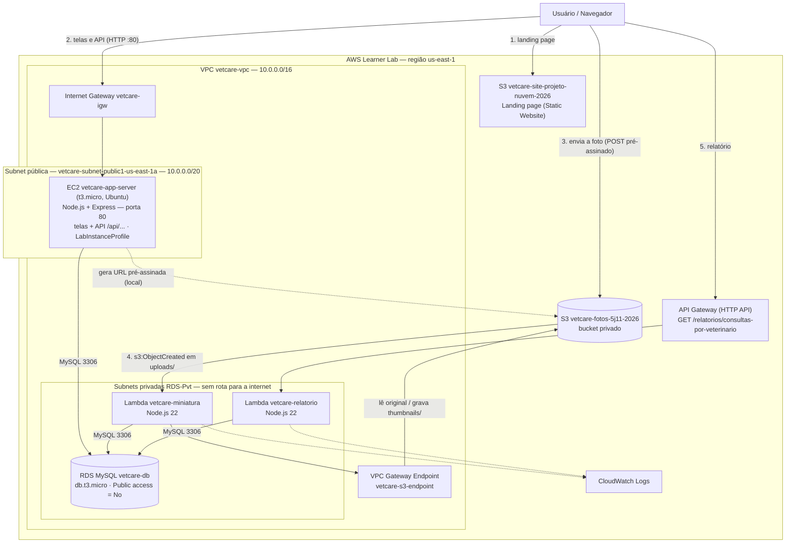
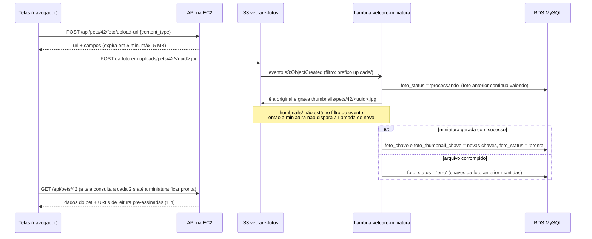
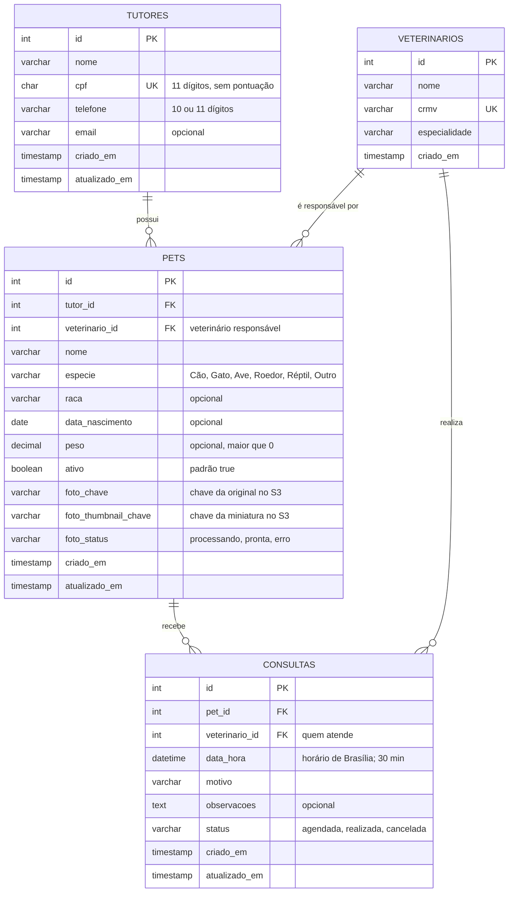

# Arquitetura e Design — VetCare

Este documento descreve **como** o VetCare atende ao que foi especificado no [`spec.md`](./spec.md): o diagrama de arquitetura na AWS, o modelo de dados, as rotas da API, os Security Groups e as decisões de arquitetura (ADRs). Ele descreve exatamente o que está implantado na AWS.

---

## 1. Diagrama de Arquitetura

### 1.1 Visão geral



| Componente | Função | Requisitos |
| :--- | :--- | :--- |
| **S3 `vetcare-site-projeto-nuvem-2026`** | Landing page pública do projeto | Entrega 16/10 |
| **EC2 `vetcare-app-server`** | Servidor Node.js/Express na subnet pública: entrega as telas e a API `/api/...` no mesmo endereço; gera as URLs pré-assinadas do S3 com o `LabInstanceProfile` | RF-01, RF-02, RF-05 a RF-09, RNF-03 |
| **RDS MySQL `vetcare-db`** | Banco relacional nas subnets privadas, sem acesso público | RF-01, RNF-01 |
| **S3 `vetcare-fotos-5j11-2026`** | Fotos originais (`uploads/`) e miniaturas (`thumbnails/`); bucket privado com CORS | RF-02, RF-03 |
| **Lambda `vetcare-miniatura`** | Disparada pelo S3 (prefixo `uploads/`): gera a miniatura e atualiza o pet no RDS; registra início, fim e erros no CloudWatch | RF-03 |
| **API Gateway `vetcare-api` + Lambda `vetcare-relatorio`** | Relatório de consultas realizadas por veterinário e espécie (JOIN + GROUP BY), chamado direto pelo navegador | RF-04 |
| **VPC Gateway Endpoint `vetcare-s3-endpoint`** | Permite que a Lambda de miniatura, sem internet, acesse o S3 (gratuito) | RF-03 |
| **CloudWatch Logs** | Logs das duas Lambdas | RF-03 |

### 1.2 Rede

| Recurso | Nome | Configuração |
| :--- | :--- | :--- |
| VPC | `vetcare-vpc` | `10.0.0.0/16` |
| Subnet pública | `vetcare-subnet-public1-us-east-1a` | `10.0.0.0/20` — onde fica a EC2 |
| Subnet privada | `vetcare-subnet-private1-us-east-1a` | `10.0.128.0/20` — reservada para recursos internos |
| Subnets privadas do RDS e das Lambdas | `RDS-Pvt-subnet-1` a `RDS-Pvt-subnet-5` | `10.0.16.0/25` a `10.0.18.0/25`, em us-east-1a, b, c, e, f. Criadas pelo assistente do RDS; formam o *DB subnet group*. As Lambdas usam a `RDS-Pvt-subnet-1` e a `RDS-Pvt-subnet-2` |
| Internet Gateway | `vetcare-igw` | Associado à `vetcare-vpc` |
| Tabela de rotas pública | `vetcare-rtb-public` | `10.0.0.0/16 → local` · `0.0.0.0/0 → Internet Gateway` |
| Tabelas de rotas privadas | `vetcare-rtb-private1-us-east-1a` e `RDS-Pvt-rt` | `10.0.0.0/16 → local` · lista de prefixos do S3 → **Gateway Endpoint**. **Sem rota para a internet** |
| VPC Gateway Endpoint | `vetcare-s3-endpoint` | Serviço `com.amazonaws.us-east-1.s3`, tipo Gateway, associado às tabelas de rotas privadas |
| NAT Gateway | — | **Não existe** (evita custo no Learner Lab) |

**Como os recursos estão organizados:** a EC2 fica na subnet pública porque recebe os acessos do navegador (porta 80). O RDS e as Lambdas ficam nas subnets privadas, que só têm a rota `local` e a rota para o S3 pelo Gateway Endpoint: eles são alcançáveis apenas de dentro da VPC. A EC2 e as Lambdas falam com o RDS pela rede interna, na porta 3306, controlada pelos Security Groups (seção 4).

### 1.3 Fluxo de upload da foto e geração da miniatura



**Convenção de nomes no bucket `vetcare-fotos-5j11-2026`:**

| Prefixo | Conteúdo | Dispara a Lambda? |
| :--- | :--- | :--- |
| `uploads/pets/{pet_id}/{uuid}.{jpg\|png}` | Foto original enviada pelo navegador | **Sim** (filtro do evento) |
| `thumbnails/pets/{pet_id}/{uuid}.jpg` | Miniatura de até 150x150 px gerada pela Lambda | Não |

A Lambda extrai o `pet_id` do próprio caminho do arquivo e só troca `foto_chave` e `foto_thumbnail_chave` **depois** que a miniatura foi gravada com sucesso:

* **Imagem corrompida:** registra o erro no CloudWatch, marca `foto_status = 'erro'` e mantém as chaves da foto anterior.
* **Pet inexistente no caminho:** registra o erro no CloudWatch e não altera nenhum registro.

---

## 2. Modelo Entidade-Relacionamento

### 2.1 Diagrama ER



**Relacionamentos:**
* **Tutor 1:N Pet** — todo pet pertence a exatamente um tutor (RF-01).
* **Veterinário 1:N Pet** — todo pet tem um veterinário responsável.
* **Pet N:N Veterinário, por meio de Consultas** — um pet pode ser atendido por vários veterinários, e um veterinário atende vários pets (RF-06).

### 2.2 Script SQL (MySQL)

O script versionado fica em [`sql/schema.sql`](../sql/schema.sql) e é executado a partir da EC2 (passo 4.8 do README). Ele cria o banco, as tabelas `veterinarios`, `tutores`, `pets` e `consultas` (com chaves estrangeiras `RESTRICT` e restrições `CHECK`) e faz a carga inicial dos 3 veterinários. Pode ser executado mais de uma vez sem duplicar dados.

Trecho da tabela de consultas:

```sql
CREATE TABLE IF NOT EXISTS consultas (
    id             INT AUTO_INCREMENT PRIMARY KEY,
    pet_id         INT          NOT NULL,
    veterinario_id INT          NOT NULL,
    data_hora      DATETIME     NOT NULL,            -- horário de Brasília
    motivo         VARCHAR(200) NOT NULL,
    observacoes    TEXT,
    status         VARCHAR(10)  NOT NULL DEFAULT 'agendada',
    CONSTRAINT fk_consultas_pet         FOREIGN KEY (pet_id)         REFERENCES pets(id)         ON DELETE RESTRICT,
    CONSTRAINT fk_consultas_veterinario FOREIGN KEY (veterinario_id) REFERENCES veterinarios(id) ON DELETE RESTRICT,
    CONSTRAINT chk_consultas_status CHECK (status IN ('agendada', 'realizada', 'cancelada')),
    INDEX idx_consultas_vet_data (veterinario_id, data_hora),
    INDEX idx_consultas_pet_data (pet_id, data_hora)
);
```

### 2.3 Onde cada regra da spec é garantida

| Regra (spec) | Banco de dados | Aplicação |
| :--- | :--- | :--- |
| CPF único, com ou sem pontuação (US-01) | `UNIQUE` + CPF gravado só com dígitos | Remove a pontuação e exige 11 dígitos (CPF fictício é aceito); duplicidade → **409** "CPF já cadastrado" |
| Tutor com pets não pode ser excluído (US-01) | `ON DELETE RESTRICT` | Conta os pets antes de excluir → **409** "Tutor possui pets cadastrados" |
| CPF mascarado na listagem (US-01, RNF-06) | — | `GET /api/tutores` devolve `***.456.789-**`; o CPF completo só em `GET /api/tutores/{id}` |
| Espécie válida e peso positivo (US-02) | `CHECK` | Validação antes do `INSERT`/`UPDATE` → **400** |
| Pet com consultas não pode ser excluído (US-02) | `ON DELETE RESTRICT` | → **409** "Pet possui consultas; utilize a inativação" |
| Inativar pet cancela consultas futuras (US-02) | — | `UPDATE` do pet e das consultas na **mesma transação**; a resposta informa quantas foram canceladas |
| Busca sem diferenciar maiúsculas e acentos (US-03) | Collation `utf8mb4_0900_ai_ci` | `WHERE nome LIKE ?` |
| Listagens em páginas de 20 itens (US-03) | — | Paginação nas telas de tutores e pets |
| Foto JPG/PNG até 5 MB (US-04) | — | Tela valida antes; a API só assina JPG/PNG; o **próprio S3** recusa arquivos maiores (`content-length-range`) |
| Miniatura sem loop (US-05) | — | Gatilho do S3 só no prefixo `uploads/`; a Lambda grava em `thumbnails/` |
| Sem consultas sobrepostas, inclusive simultâneas (US-06) | Índices por veterinário e pet | Transação com `SELECT ... FOR UPDATE` nas linhas do veterinário e do pet antes de verificar o intervalo `[início, início + 30 min)` → **409** (ADR-004) |
| Remarcar sem conflitar consigo mesma (US-06) | — | A verificação ignora a própria consulta (`id <> ?`) |
| Horário de funcionamento, data passada, pet inativo (US-06) | — | Validação na API (fuso America/Sao_Paulo) → **400** |
| Fluxo de status da consulta (US-06) | `CHECK` dos valores possíveis | Só `agendada → realizada` (após o horário) ou `agendada → cancelada`; demais → **409** |
| Relatório só com consultas realizadas (US-08) | — | `WHERE c.status = 'realizada'` na Lambda |
| CPF e telefone fora dos logs (RNF-06) | — | O log da EC2 registra apenas método, caminho e status; as Lambdas registram apenas chaves de arquivo e IDs |

---

## 3. Rotas da API

### 3.1 API da aplicação (EC2)

**Base:** `http://<IP-público-da-EC2>/api`. As telas são servidas pelo mesmo servidor e chamam a API pelo caminho relativo `/api/...`, sem IP fixo no código (RNF-03).

| Método | Rota | Descrição | Sucesso | Erros | Requisito |
| :--- | :--- | :--- | :--- | :--- | :--- |
| `GET` | `/api/health` | Verifica a conexão com o RDS | 200 | 500 | RNF-01 |
| `GET` | `/api/config` | Endereço do relatório no API Gateway (lido do `.env`) | 200 | — | RF-04, RNF-03 |
| `GET` | `/api/veterinarios` | Lista os veterinários (carga inicial) | 200 | — | RF-01 |
| `GET` | `/api/tutores?busca=` | Lista em ordem alfabética, CPF mascarado, total de pets. `busca` = trecho do nome ou CPF | 200 | — | RF-01, RF-08 |
| `GET` | `/api/tutores/{id}` | Detalhe do tutor, com CPF completo | 200 | 400, 404 | RF-01 |
| `POST` | `/api/tutores` | Cadastra um tutor | 201 | 400, 409 | RF-01 |
| `PUT` | `/api/tutores/{id}` | Edita um tutor | 200 | 400, 404, 409 | RF-01 |
| `DELETE` | `/api/tutores/{id}` | Exclui um tutor sem pets | 204 | 404, 409 | RF-01 |
| `GET` | `/api/tutores/{id}/pets` | Todos os pets do tutor, inclusive inativos | 200 | 404 | RF-01 |
| `GET` | `/api/pets?situacao=&especie=&tutor_id=` | Lista pets com tutor, veterinário e URLs da foto. `situacao` = `ativo` (padrão), `inativo` ou `todos` | 200 | 400 | RF-01, RF-08 |
| `GET` | `/api/pets/{id}` | Detalhe do pet | 200 | 400, 404 | RF-01 |
| `POST` | `/api/pets` | Cadastra um pet | 201 | 400 | RF-01 |
| `PUT` | `/api/pets/{id}` | Edita um pet | 200 | 400, 404 | RF-01 |
| `PATCH` | `/api/pets/{id}/situacao` | Inativa ou reativa (`{"ativo": false}`); retorna quantas consultas futuras foram canceladas | 200 | 400, 404 | RF-09 |
| `DELETE` | `/api/pets/{id}` | Exclui um pet sem consultas | 204 | 404, 409 | RF-01 |
| `POST` | `/api/pets/{id}/foto/upload-url` | Gera o POST pré-assinado para a foto (`{"content_type": "image/jpeg"}`) | 200 | 400, 404, 503 | RF-02 |
| `GET` | `/api/pets/{id}/consultas?status=` | Histórico do pet, da mais recente para a mais antiga | 200 | 400, 404 | RF-07 |
| `GET` | `/api/consultas?data=&veterinario_id=` | Agenda, em ordem de horário | 200 | 400 | RF-06 |
| `GET` | `/api/consultas/{id}` | Detalhe da consulta | 200 | 400, 404 | RF-06 |
| `POST` | `/api/consultas` | Agenda (data futura) ou registra atendimento já realizado (`"realizada": true`, data atual ou passada) | 201 | 400, 409 | RF-06 |
| `PUT` | `/api/consultas/{id}` | Remarca uma consulta `agendada` | 200 | 400, 404, 409 | RF-06 |
| `PATCH` | `/api/consultas/{id}/status` | Registra como `realizada` (após o horário, com observações) ou `cancelada` | 200 | 400, 404, 409 | RF-06 |

### 3.2 Relatório (API Gateway + Lambda)

| Método | Rota | Descrição | Executa em | Requisito |
| :--- | :--- | :--- | :--- | :--- |
| `GET` | `https://{api-id}.execute-api.us-east-1.amazonaws.com/relatorios/consultas-por-veterinario?inicio=&fim=` | Consultas realizadas por veterinário e espécie no período (padrão: últimos 30 dias); **400** se a data inicial for maior que a final | API Gateway `vetcare-api` → Lambda `vetcare-relatorio` | RF-04 |

O endereço fica no `.env` da EC2 (`RELATORIO_API_URL`) e chega às telas por `GET /api/config`. O CORS está configurado no API Gateway (origem `*`, método `GET`).

Consulta SQL da Lambda:

```sql
SELECT v.nome    AS veterinario,
       p.especie AS especie,
       COUNT(*)  AS total_consultas
  FROM consultas c
  JOIN pets p         ON p.id = c.pet_id
  JOIN veterinarios v ON v.id = c.veterinario_id
 WHERE c.status = 'realizada'
   AND c.data_hora >= ?
   AND c.data_hora <  DATE_ADD(?, INTERVAL 1 DAY)
 GROUP BY v.nome, p.especie
 ORDER BY v.nome, total_consultas DESC;
```

Formato da resposta:

```json
{
  "periodo": { "inicio": "2026-10-01", "fim": "2026-10-31" },
  "resultado": [
    { "veterinario": "Dra. Camila Rocha", "especie": "Cão",  "total_consultas": 12 },
    { "veterinario": "Dra. Camila Rocha", "especie": "Gato", "total_consultas": 5 }
  ]
}
```

### 3.3 Padrões comuns

* **Formato:** JSON em todas as requisições e respostas.
* **Erro:** `{ "erro": "mensagem legível" }`, com o código HTTP indicado nas tabelas.
* **CPF:** recebido com ou sem pontuação, gravado só com dígitos e devolvido mascarado nas listagens.
* **Datas das consultas:** gravadas no horário de Brasília (`America/Sao_Paulo`).
* **Fotos:** o banco guarda apenas a **chave** do arquivo no S3; a API gera URLs de leitura pré-assinadas válidas por 1 hora.
* **CORS:** no bucket `vetcare-fotos-5j11-2026` (métodos `GET` e `POST`, origem `*`, já que o IP da EC2 muda) e no API Gateway.
* **Logs:** apenas data, método, caminho e status (ex.: `POST /api/tutores -> 201`); CPF e telefone nunca são registrados (RNF-06).

---

## 4. Security Groups

| Security Group | Associado a | Entrada (inbound) | Saída (outbound) |
| :--- | :--- | :--- | :--- |
| **`vetcare-ec2-sg`** | EC2 `vetcare-app-server` | **HTTP 80** de `0.0.0.0/0` (telas e API) · **SSH 22** de `18.206.107.24/29` (faixa do EC2 Instance Connect em us-east-1) | Todo o tráfego (padrão): instalar pacotes, acessar o RDS e assinar URLs do S3 |
| **`vetcare-rds-sg`** | RDS `vetcare-db` | **MySQL 3306** somente dos security groups `vetcare-ec2-sg` e `vetcare-lambda-sg` | Padrão |
| **`vetcare-lambda-sg`** | Lambdas `vetcare-miniatura` e `vetcare-relatorio` | **Nenhuma** (Lambdas não recebem conexões; são invocadas pela AWS) | Todo o tráfego (padrão): RDS na 3306 e S3 pelo Gateway Endpoint |
| **`ec2-rds-1`** | EC2 `vetcare-app-server` | Nenhuma | Criado automaticamente pelo assistente do RDS |
| **`rds-ec2-1`** | RDS `vetcare-db` | **MySQL 3306** somente do security group `ec2-rds-1` | Criado automaticamente pelo assistente do RDS |

**Como a aplicação acessa o banco:** o navegador nunca fala com o RDS. Ele acessa a EC2 pela porta 80 (ou o API Gateway, no caso do relatório). A EC2 e as Lambdas abrem a conexão MySQL com o RDS pela rede interna da VPC, na porta 3306. O RDS aceita essa porta **apenas** de quem tem o security group da EC2 ou das Lambdas (as regras usam o *ID do security group* como origem, e não um IP). Como o banco foi criado com **Public access = No** e está em subnets sem rota para a internet, ele não é alcançável de fora da VPC.

**Recursos sem Security Group:** S3 e API Gateway são serviços gerenciados fora da VPC. O controle de acesso deles é feito pela **LabRole** (Lambdas), pelo **LabInstanceProfile** (EC2) e pelas **políticas dos buckets**:
* `vetcare-site-projeto-nuvem-2026`: leitura pública (`s3:GetObject`) apenas dos arquivos do site.
* `vetcare-fotos-5j11-2026`: *Block Public Access* ligado; acesso somente por URLs pré-assinadas e pelas permissões da LabRole.

---

## 5. Decisões de Arquitetura (ADRs)

### Contexto comum: restrições do AWS Learner Lab

* Apenas as regiões `us-east-1` e `us-west-2`; o projeto usa **`us-east-1`**.
* Não é possível criar roles IAM: Lambdas usam a **`LabRole`** e a EC2 usa o **`LabInstanceProfile`**.
* Orçamento limitado: se for ultrapassado, a conta e **todos os recursos são apagados**. EC2, RDS e NAT Gateway ligados são os que mais consomem.
* O **IP público da EC2 muda** a cada nova sessão.
* O RDS não é parado ao fim da sessão e é religado automaticamente após 7 dias parado.
* Lambda dentro da VPC não tem acesso à internet.
* No máximo **10 execuções simultâneas** de Lambda na conta.

---

### ADR-001: CRUD executado em EC2 com Node.js (RNF-04)

* **Status:** Aceita em 23/10/2026. **Substitui** a decisão de 16/10, que previa o CRUD em Lambda + API Gateway.
* **Contexto:** o CRUD de tutores e pets precisa ficar acessível pelo navegador, conectado ao RDS privado, e voltar a funcionar a cada nova sessão do Learner Lab sem endereços fixos no código (RNF-03).
* **Alternativas consideradas:**

| Opção | Vantagens | Desvantagens |
| :--- | :--- | :--- |
| **A. EC2 + Node.js/Express** | Um único servidor entrega as telas e a API; conexão persistente com o banco; sem cold start; depuração direta no terminal | IP público muda a cada sessão; instância ligada consome orçamento; o servidor precisa ser iniciado manualmente |
| **B. ECS (Fargate ou EC2)** | Containers gerenciados | Configuração mais complexa no Learner Lab e Load Balancer cobrado por hora para ter endereço fixo |
| **C. Lambda + API Gateway** | Endereço HTTPS fixo; cobrança por execução | Lambda na VPC sem internet; dependências empacotadas manualmente; cold start; depuração mais difícil para o grupo |

* **Decisão:** **opção A** para o CRUD. As **Lambdas** foram usadas onde o enunciado as exige: a miniatura disparada pelo S3 (RF-03) e o relatório exposto pelo API Gateway (RF-04).
* **Justificativa:**
  1. A EC2 entrega as telas **e** a API no mesmo endereço. As telas chamam `/api/...` com caminho relativo, então **nenhum IP fica no código** (RNF-03).
  2. A EC2 está na mesma VPC que o RDS e se conecta a ele pela rede interna, protegida pelos Security Groups (RNF-01).
  3. O grupo consegue instalar, testar e corrigir a aplicação diretamente no terminal da instância.
* **Consequências:**
  * ➕ Arquitetura simples de demonstrar: navegador → EC2 → RDS.
  * ➖ O **endereço de acesso muda** a cada sessão (o código não muda). O README explica como obter o IP atual.
  * ➖ A instância consome orçamento enquanto estiver ligada: deve ser **parada** ao fim de cada sessão.
  * ➖ O servidor fica no ar enquanto o terminal estiver aberto. Melhoria futura: serviço `systemd`.

---

### ADR-002: Credenciais em arquivo `.env` na EC2 e em variáveis de ambiente das Lambdas (RNF-02)

* **Status:** Aceita em 23/10/2026; ampliada para as Lambdas em 05/11/2026.
* **Contexto:** a aplicação e as Lambdas precisam do endereço, usuário e senha do RDS, e nenhuma credencial pode ir para o repositório. Uma primeira versão do código gerada por IA trazia a senha no próprio `server.js`, e a senha chegou a ser exposta em um link compartilhado; ela foi **trocada**.
* **Alternativas consideradas:**

| Opção | Avaliação |
| :--- | :--- |
| **A. Senha no código** | Rejeitada: viola o RNF-02 |
| **B. AWS Secrets Manager** | Bônus no enunciado; de dentro das subnets privadas, as Lambdas precisariam de um **Interface Endpoint**, cobrado por hora |
| **C. `.env` na EC2 + variáveis de ambiente das Lambdas** | Configurados pelo console/terminal, fora do repositório, sem custo |

* **Decisão:** **opção C**. O repositório contém apenas o modelo [`src/app/.env.example`](../src/app/.env.example), e o `.gitignore` impede o envio do `.env`.
* **Consequências:**
  * ➕ Nenhuma credencial no repositório; o código lê tudo de `process.env`.
  * ➖ Quem tem acesso ao terminal da EC2 ou ao console das Lambdas consegue ver as credenciais; não há rotação automática.

---

### ADR-003: Banco MySQL no RDS

* **Status:** Aceita em 23/10/2026. **Substitui** a escolha de PostgreSQL feita em 16/10.
* **Contexto:** o banco foi criado como **MySQL** no momento da implantação; recriar como PostgreSQL atrasaria a entrega.
* **Decisão:** manter o **RDS MySQL** (`db.t3.micro`) e adaptar o design e o script SQL.
* **Consequências:**
  * ➕ A collation padrão `utf8mb4_0900_ai_ci` já ignora maiúsculas e acentos, atendendo à busca da US-03.
  * ➕ Restrições `CHECK` (MySQL 8) e chaves estrangeiras `RESTRICT` garantem a integridade no próprio banco.
  * ➖ O MySQL não tem a restrição `EXCLUDE` do PostgreSQL, então o conflito de agenda é controlado pela aplicação (ADR-004).

---

### ADR-004: Conflito de agenda controlado por transação na aplicação (RF-06)

* **Status:** Aceita em 23/10/2026; implementada em 05/11/2026.
* **Contexto:** a US-06 exige que um veterinário e um pet não tenham consultas sobrepostas, **inclusive quando dois agendamentos chegam ao mesmo tempo**.
* **Decisão:** ao agendar ou remarcar, a API abre uma transação, bloqueia as linhas do veterinário e do pet com `SELECT ... FOR UPDATE`, verifica se existe consulta não cancelada no intervalo `[início, início + 30 min)` e só então grava.
* **Justificativa:** sem o bloqueio, duas requisições simultâneas poderiam verificar o horário ao mesmo tempo, não encontrar conflito e gravar as duas. Com o bloqueio, a segunda espera a primeira terminar e recebe **409**.
* **Consequências:**
  * ➕ Funciona no MySQL sem recursos adicionais; intervalos que apenas se encostam (10:00–10:30 e 10:30) são aceitos.
  * ➖ A regra fica na aplicação: acessos diretos ao banco não passam por ela.

---

### ADR-005: Bucket de fotos privado, com URLs pré-assinadas (RF-02)

* **Status:** Aceita (16/10/2026); implementada em 05/11/2026.
* **Decisão:** o bucket de fotos fica privado (*Block Public Access* ligado). A API na EC2 gera um **POST pré-assinado** (`content-length-range` até 5 MB, `Content-Type` fixo, validade de 5 minutos) usando o `LabInstanceProfile`. O banco guarda só a **chave** do arquivo, e a API gera URLs de leitura válidas por 1 hora.
* **Consequências:**
  * ➕ Nenhuma foto fica pública, e o próprio S3 recusa arquivos grandes ou de outro tipo.
  * ➖ As URLs de leitura expiram; a tela busca o pet de novo para renová-las.
  * ➖ O CORS do bucket aceita qualquer origem, porque o IP da EC2 muda; o envio continua exigindo a URL assinada.

---

### ADR-006: Lambdas em Node.js 22 com Jimp, sem Lambda Layer

* **Status:** Aceita em 05/11/2026.
* **Contexto:** a Lambda de miniatura precisa de uma biblioteca de imagens e de um driver MySQL. Como ela roda na VPC sem internet, as dependências precisam ir no pacote `.zip`.
* **Alternativas consideradas:** (A) Python com Pillow, que exige uma *Lambda Layer* compilada para o runtime; (B) Node.js com **Jimp**, biblioteca de imagens escrita só em JavaScript.
* **Decisão:** **opção B**. As duas Lambdas usam Node.js 22.x (a mesma linguagem da EC2) e levam `jimp` e `mysql2` no `.zip`; o SDK da AWS já vem no runtime.
* **Consequências:**
  * ➕ Um único `.zip` por função, sem compilação nem Layer; mesma linguagem em todo o projeto.
  * ➖ O Jimp é mais lento que bibliotecas nativas; por isso a Lambda de miniatura usa 1024 MB de memória e 30 s de tempo limite.
