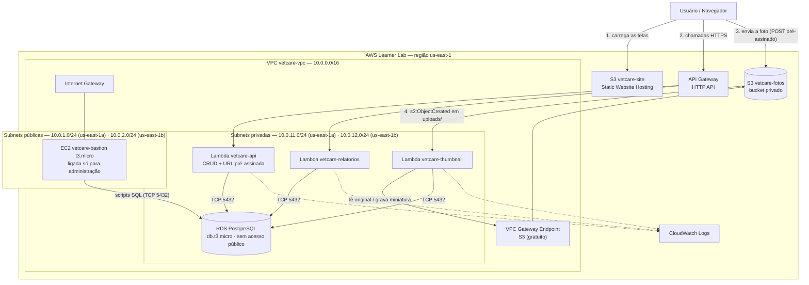
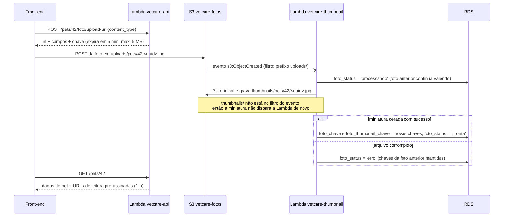
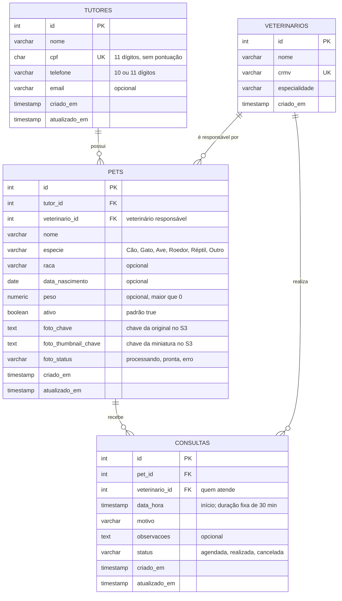

# Arquitetura e Design — VetCare

Este documento descreve **como** o VetCare atende ao que foi especificado no [`spec.md`](./spec.md): o diagrama de arquitetura na AWS, o modelo de dados, as rotas da API, os Security Groups e as decisões de arquitetura (ADRs).

---

## 1. Diagrama de Arquitetura

### 1.1 Visão geral



| Componente | Função | Requisitos |
| :--- | :--- | :--- |
| **S3 `vetcare-site`** | Hospeda o front-end (HTML, CSS, JS) como site estático público | RF-05 |
| **API Gateway (HTTP API)** | Endpoint HTTPS fixo da API, com CORS liberado para a origem do site | RF-01, RF-04, RNF-03 |
| **Lambda `vetcare-api`** | CRUD de tutores, pets e consultas; listagem de veterinários; busca; geração das URLs pré-assinadas | RF-01, RF-02, RF-06 a RF-09 |
| **Lambda `vetcare-relatorios`** | Relatório de consultas por veterinário e espécie (JOIN + GROUP BY) | RF-04 |
| **Lambda `vetcare-thumbnail`** | Disparada pelo S3; gera a miniatura e atualiza o pet no RDS | RF-03 |
| **S3 `vetcare-fotos`** | Guarda as fotos originais (`uploads/`) e as miniaturas (`thumbnails/`); totalmente privado | RF-02, RF-03 |
| **RDS PostgreSQL** | Banco relacional do sistema, em subnets privadas | RF-01, RNF-01 |
| **EC2 `vetcare-bastion`** | Máquina de administração na subnet pública, usada para executar os scripts SQL e inspecionar o banco; fica **desligada** fora desses momentos | RNF-01 |
| **VPC Gateway Endpoint (S3)** | Permite que a Lambda de miniatura, sem internet, acesse o S3 | RF-03 |
| **CloudWatch Logs** | Logs de todas as Lambdas, incluindo início, fim e erros do processamento de miniaturas | RF-03 |

### 1.2 Rede

| Recurso | Configuração |
| :--- | :--- |
| VPC | `vetcare-vpc` — `10.0.0.0/16` |
| Subnet pública A | `vetcare-public-1a` — `10.0.1.0/24` — us-east-1a — IP público automático |
| Subnet pública B | `vetcare-public-1b` — `10.0.2.0/24` — us-east-1b — IP público automático |
| Subnet privada A | `vetcare-private-1a` — `10.0.11.0/24` — us-east-1a |
| Subnet privada B | `vetcare-private-1b` — `10.0.12.0/24` — us-east-1b |
| Tabela de rotas pública | `10.0.0.0/16 → local` · `0.0.0.0/0 → Internet Gateway` |
| Tabela de rotas privada | `10.0.0.0/16 → local` · prefix list do S3 → **Gateway Endpoint**. **Sem rota para a internet e sem NAT Gateway** |
| DB Subnet Group | `vetcare-db-subnets` — subnets privadas A e B (o RDS exige 2 AZs) |

As Lambdas que acessam o RDS são associadas às duas subnets privadas. A `vetcare-api` e a `vetcare-relatorios` não precisam de acesso ao S3 pela rede: a assinatura das URLs pré-assinadas é calculada localmente com as credenciais da LabRole.

### 1.3 Fluxo de upload da foto e geração da miniatura



**Convenção de nomes no bucket `vetcare-fotos`:**

| Prefixo | Conteúdo | Dispara a Lambda? |
| :--- | :--- | :--- |
| `uploads/pets/{pet_id}/{uuid}.{jpg\|png}` | Foto original enviada pelo navegador | **Sim** (filtro do evento) |
| `thumbnails/pets/{pet_id}/{uuid}.jpg` | Miniatura 150x150 px gerada pela Lambda | Não |

A Lambda extrai o `pet_id` do próprio caminho do arquivo e só troca `foto_chave` e `foto_thumbnail_chave` **depois** que a miniatura foi gravada com sucesso. Comportamento em caso de falha:

* **Imagem corrompida:** registra o erro no CloudWatch, marca `foto_status = 'erro'` e mantém as chaves da foto anterior.
* **Pet inexistente no caminho:** registra o erro no CloudWatch e não altera nenhum registro.

---

## 2. Modelo Entidade-Relacionamento

### 2.1 Diagrama ER



**Relacionamentos:**
* **Tutor 1:N Pet** — todo pet pertence a exatamente um tutor (exigência do RF-01).
* **Veterinário 1:N Pet** — todo pet tem um veterinário responsável.
* **Pet N:N Veterinário, por meio de Consultas** — um pet pode ser atendido por vários veterinários, e um veterinário atende vários pets. A consulta pode ser com um veterinário diferente do responsável (plantão ou especialista).

### 2.2 Script DDL (PostgreSQL)

Versionado em [`sql/01_schema.sql`](../sql/01_schema.sql). Os veterinários são inseridos por [`sql/02_seed.sql`](../sql/02_seed.sql).

```sql
-- Necessária para a restrição de horário sobreposto (EXCLUDE com '=' em colunas inteiras)
CREATE EXTENSION IF NOT EXISTS btree_gist;

-- Necessária para a busca de tutores sem diferenciar acentos (ex.: "jose" encontra "José")
CREATE EXTENSION IF NOT EXISTS unaccent;

-- Datas e horas são gravadas no horário de Brasília (America/Sao_Paulo)

CREATE TABLE veterinarios (
    id            SERIAL PRIMARY KEY,
    nome          VARCHAR(100) NOT NULL,
    crmv          VARCHAR(20)  NOT NULL UNIQUE,
    especialidade VARCHAR(50)  NOT NULL,
    criado_em     TIMESTAMP    NOT NULL DEFAULT CURRENT_TIMESTAMP
);

CREATE TABLE tutores (
    id            SERIAL PRIMARY KEY,
    nome          VARCHAR(100) NOT NULL CHECK (char_length(nome) >= 3),
    cpf           CHAR(11)     NOT NULL UNIQUE CHECK (cpf ~ '^[0-9]{11}$'),
    telefone      VARCHAR(11)  NOT NULL CHECK (telefone ~ '^[0-9]{10,11}$'),
    email         VARCHAR(100),
    criado_em     TIMESTAMP    NOT NULL DEFAULT CURRENT_TIMESTAMP,
    atualizado_em TIMESTAMP    NOT NULL DEFAULT CURRENT_TIMESTAMP
);

CREATE TABLE pets (
    id                   SERIAL PRIMARY KEY,
    tutor_id             INT          NOT NULL REFERENCES tutores(id)      ON DELETE RESTRICT,
    veterinario_id       INT          NOT NULL REFERENCES veterinarios(id) ON DELETE RESTRICT,
    nome                 VARCHAR(50)  NOT NULL,
    especie              VARCHAR(10)  NOT NULL
                         CHECK (especie IN ('Cão', 'Gato', 'Ave', 'Roedor', 'Réptil', 'Outro')),
    raca                 VARCHAR(50),
    data_nascimento      DATE,
    peso                 NUMERIC(5,2) CHECK (peso > 0),
    ativo                BOOLEAN      NOT NULL DEFAULT TRUE,
    foto_chave           TEXT,
    foto_thumbnail_chave TEXT,
    foto_status          VARCHAR(12)  CHECK (foto_status IN ('processando', 'pronta', 'erro')),
    criado_em            TIMESTAMP    NOT NULL DEFAULT CURRENT_TIMESTAMP,
    atualizado_em        TIMESTAMP    NOT NULL DEFAULT CURRENT_TIMESTAMP
);

CREATE TABLE consultas (
    id             SERIAL PRIMARY KEY,
    pet_id         INT          NOT NULL REFERENCES pets(id)         ON DELETE RESTRICT,
    veterinario_id INT          NOT NULL REFERENCES veterinarios(id) ON DELETE RESTRICT,
    data_hora      TIMESTAMP    NOT NULL,
    motivo         VARCHAR(200) NOT NULL,
    observacoes    TEXT,
    status         VARCHAR(10)  NOT NULL DEFAULT 'agendada'
                   CHECK (status IN ('agendada', 'realizada', 'cancelada')),
    criado_em      TIMESTAMP    NOT NULL DEFAULT CURRENT_TIMESTAMP,
    atualizado_em  TIMESTAMP    NOT NULL DEFAULT CURRENT_TIMESTAMP,

    -- Um veterinário não pode ter duas consultas sobrepostas (intervalo [início, início + 30 min) )
    CONSTRAINT sem_conflito_veterinario EXCLUDE USING gist (
        veterinario_id WITH =,
        tsrange(data_hora, data_hora + INTERVAL '30 minutes', '[)') WITH &&
    ) WHERE (status <> 'cancelada'),

    -- Um pet não pode estar em duas consultas ao mesmo tempo
    CONSTRAINT sem_conflito_pet EXCLUDE USING gist (
        pet_id WITH =,
        tsrange(data_hora, data_hora + INTERVAL '30 minutes', '[)') WITH &&
    ) WHERE (status <> 'cancelada')
);

CREATE INDEX idx_pets_tutor          ON pets (tutor_id);
CREATE INDEX idx_pets_especie_ativo  ON pets (especie, ativo);
CREATE INDEX idx_consultas_pet_data  ON consultas (pet_id, data_hora DESC);
CREATE INDEX idx_consultas_vet_data  ON consultas (veterinario_id, data_hora);
```

### 2.3 Onde cada regra da spec é garantida

| Regra (spec) | Banco de dados | API (Lambda) |
| :--- | :--- | :--- |
| CPF único, com ou sem pontuação (US-01) | `UNIQUE` + CPF gravado só com dígitos | Remove a pontuação e valida os dígitos verificadores; erro `23505` → **409** |
| Tutor com pets não pode ser excluído (US-01) | `ON DELETE RESTRICT` | Erro `23503` → **409** "Tutor possui pets cadastrados" |
| Pet com consultas não pode ser excluído (US-02) | `ON DELETE RESTRICT` | Erro `23503` → **409** "Pet possui consultas; utilize a inativação" |
| Inativar pet cancela consultas futuras (US-02) | — | `UPDATE` do pet e das consultas na **mesma transação** |
| Sem consultas sobrepostas, inclusive simultâneas (US-06) | `EXCLUDE` com intervalo `[)` (10:30 não conflita com 10:00–10:30) | Erro `23P01` → **409** com a mensagem do conflito (veterinário ou pet) |
| Busca de tutor sem diferenciar maiúsculas e acentos (US-03) | Extensão `unaccent` | `WHERE unaccent(nome) ILIKE unaccent('%' || termo || '%')` |
| Remarcar sem conflitar consigo mesma (US-06) | O `UPDATE` substitui a própria linha, então ela não conflita consigo | — |
| Horário de funcionamento, data passada, pet inativo (US-06) | — | Validação antes do `INSERT`/`UPDATE` → **400** (fuso America/Sao_Paulo) |
| Fluxo de status da consulta (US-06) | `CHECK` dos valores possíveis | Só permite `agendada → realizada` (se o horário já chegou) ou `agendada → cancelada`; demais → **409** |

---

## 3. Rotas da API

**Base:** `https://{api-id}.execute-api.us-east-1.amazonaws.com` (API Gateway HTTP API). O endereço fica apenas no arquivo `config.js` do front-end.

### 3.1 Veterinários

| Método | Rota | Descrição | Sucesso | Erros | Lambda | Requisito |
| :--- | :--- | :--- | :--- | :--- | :--- | :--- |
| `GET` | `/veterinarios` | Lista os veterinários para os formulários | 200 | — | vetcare-api | RF-01 |

### 3.2 Tutores

| Método | Rota | Descrição | Sucesso | Erros | Lambda | Requisito |
| :--- | :--- | :--- | :--- | :--- | :--- | :--- |
| `GET` | `/tutores?busca=&pagina=&limite=` | Lista em ordem alfabética, com CPF mascarado. `busca` aceita trecho do nome (sem diferenciar maiúsculas e acentos, via `unaccent`) ou CPF | 200 | 400 | vetcare-api | RF-01, RF-08, RNF-06 |
| `GET` | `/tutores/{id}` | Detalhe do tutor, com CPF completo | 200 | 404 | vetcare-api | RF-01 |
| `POST` | `/tutores` | Cadastra um tutor | 201 | 400, 409 | vetcare-api | RF-01 |
| `PUT` | `/tutores/{id}` | Edita um tutor | 200 | 400, 404, 409 | vetcare-api | RF-01 |
| `DELETE` | `/tutores/{id}` | Exclui um tutor sem pets | 204 | 404, 409 | vetcare-api | RF-01 |
| `GET` | `/tutores/{id}/pets` | Todos os pets do tutor, incluindo inativos | 200 | 404 | vetcare-api | RF-01 |

### 3.3 Pets

| Método | Rota | Descrição | Sucesso | Erros | Lambda | Requisito |
| :--- | :--- | :--- | :--- | :--- | :--- | :--- |
| `GET` | `/pets?especie=&tutor_id=&situacao=&pagina=&limite=` | Lista pets. `situacao` = `ativo` (padrão), `inativo` ou `todos` | 200 | 400 | vetcare-api | RF-01, RF-08 |
| `GET` | `/pets/{id}` | Detalhe do pet, com URLs de leitura da foto e da miniatura | 200 | 404 | vetcare-api | RF-01 |
| `POST` | `/pets` | Cadastra um pet | 201 | 400 | vetcare-api | RF-01 |
| `PUT` | `/pets/{id}` | Edita um pet | 200 | 400, 404 | vetcare-api | RF-01 |
| `DELETE` | `/pets/{id}` | Exclui um pet sem consultas | 204 | 404, 409 | vetcare-api | RF-01 |
| `PATCH` | `/pets/{id}/situacao` | Inativa ou reativa (`{"ativo": false}`). Ao inativar, retorna quantas consultas futuras foram canceladas | 200 | 400, 404 | vetcare-api | RF-09 |
| `POST` | `/pets/{id}/foto/upload-url` | Gera o POST pré-assinado para a foto (`{"content_type": "image/jpeg"}`) | 200 | 400, 404 | vetcare-api | RF-02 |
| `GET` | `/pets/{id}/consultas?status=` | Histórico do pet, da mais recente para a mais antiga | 200 | 404 | vetcare-api | RF-07 |

### 3.4 Consultas

| Método | Rota | Descrição | Sucesso | Erros | Lambda | Requisito |
| :--- | :--- | :--- | :--- | :--- | :--- | :--- |
| `GET` | `/consultas?veterinario_id=&data=` | Agenda do dia, em ordem de horário | 200 | 400 | vetcare-api | RF-06 |
| `GET` | `/consultas/{id}` | Detalhe da consulta | 200 | 404 | vetcare-api | RF-06 |
| `POST` | `/consultas` | Agenda uma consulta | 201 | 400, 409 | vetcare-api | RF-06 |
| `PUT` | `/consultas/{id}` | Remarca (data/hora, veterinário, motivo) uma consulta `agendada` | 200 | 400, 404, 409 | vetcare-api | RF-06 |
| `PATCH` | `/consultas/{id}/status` | Registra como `realizada` (com observações) ou `cancelada` | 200 | 400, 404, 409 | vetcare-api | RF-06 |

### 3.5 Relatório

| Método | Rota | Descrição | Sucesso | Erros | Lambda | Requisito |
| :--- | :--- | :--- | :--- | :--- | :--- | :--- |
| `GET` | `/relatorios/consultas-por-veterinario?inicio=&fim=` | Consultas realizadas por veterinário e espécie no período (padrão: últimos 30 dias) | 200 | 400 | vetcare-relatorios | RF-04 |

Consulta SQL do relatório:

```sql
SELECT v.nome     AS veterinario,
       p.especie  AS especie,
       COUNT(*)   AS total_consultas
FROM consultas c
JOIN pets p         ON p.id = c.pet_id
JOIN veterinarios v ON v.id = c.veterinario_id
WHERE c.status = 'realizada'
  AND c.data_hora >= %(inicio)s
  AND c.data_hora <  %(fim)s + INTERVAL '1 day'
GROUP BY v.nome, p.especie
ORDER BY v.nome, total_consultas DESC;
```

Formato da resposta:

```json
{
  "periodo": { "inicio": "2026-10-01", "fim": "2026-10-31" },
  "resultado": [
    { "veterinario": "Dra. Camila Rocha", "especie": "Cão",  "total_consultas": 12 },
    { "veterinario": "Dra. Camila Rocha", "especie": "Gato", "total_consultas": 5 }
  ]
}
```

### 3.6 Padrões comuns

* **Formato:** JSON em todas as requisições e respostas.
* **Erro:** `{ "erro": "mensagem legível" }`, com o código HTTP indicado nas tabelas.
* **Paginação:** parâmetros `pagina` (padrão 1) e `limite` (padrão 20, máximo 100). Resposta: `{ "dados": [...], "pagina": 1, "limite": 20, "total": 57 }`.
* **CPF:** recebido com ou sem pontuação, gravado só com dígitos e devolvido mascarado (`***.456.789-**`) nas listagens.
* **Logs:** CPF e telefone nunca são registrados no CloudWatch; os logs identificam registros apenas pelo `id` (RNF-06).
* **Fotos:** o banco guarda apenas a **chave** do arquivo no S3. Nas respostas, a API gera URLs de leitura pré-assinadas válidas por 1 hora.
* **CORS:** configurado no API Gateway (origem do site, métodos `GET, POST, PUT, PATCH, DELETE`, cabeçalho `Content-Type`) e no bucket `vetcare-fotos` (método `POST` a partir da origem do site).

---

## 4. Security Groups

| Security Group | Associado a | Entrada (inbound) | Saída (outbound) |
| :--- | :--- | :--- | :--- |
| **`sg-vetcare-lambda`** | Lambdas `vetcare-api`, `vetcare-relatorios` e `vetcare-thumbnail` | **Nenhuma** (Lambdas não recebem conexões; são invocadas pela AWS) | TCP **5432** → `sg-vetcare-rds` · TCP **443** → prefix list do S3 (`com.amazonaws.us-east-1.s3`), usada pelo Gateway Endpoint |
| **`sg-vetcare-rds`** | Instância RDS PostgreSQL | TCP **5432** somente de `sg-vetcare-lambda` e de `sg-vetcare-bastion` | Nenhuma (as respostas às conexões recebidas são liberadas automaticamente, pois o SG é *stateful*) |
| **`sg-vetcare-bastion`** | EC2 `vetcare-bastion` (subnet pública) | TCP **22** somente da faixa do **EC2 Instance Connect** em us-east-1 (`18.206.107.24/29`), sem expor o SSH para a internet | TCP **5432** → `sg-vetcare-rds` · TCP **443** → `0.0.0.0/0` (instalar o cliente `psql`) |

**Como a aplicação acessa o banco:** o navegador nunca fala com o RDS. Ele chama o API Gateway, que invoca a Lambda. A Lambda roda nas subnets privadas com o `sg-vetcare-lambda`, e o `sg-vetcare-rds` só aceita a porta 5432 vinda desse SG (e do bastion, para administração). Como o RDS foi criado com "Acesso público = Não" e está em subnets sem rota para a internet, ele não é alcançável de fora da VPC.

**Recursos sem Security Group:** API Gateway e S3 são serviços gerenciados fora da VPC. O controle de acesso deles é feito pela **LabRole** (permissões das Lambdas) e pelas **políticas dos buckets**:
* `vetcare-site`: leitura pública (`s3:GetObject`) apenas dos arquivos do site.
* `vetcare-fotos`: *Block Public Access* ligado; acesso somente por URLs pré-assinadas e pela LabRole.

---

## 5. Decisões de Arquitetura (ADRs)

### Contexto comum: restrições do AWS Learner Lab

Todas as decisões abaixo consideram estas restrições do ambiente:

* Apenas as regiões `us-east-1` e `us-west-2`; o projeto usa **`us-east-1`**.
* Não é possível criar roles IAM: todas as Lambdas usam a **`LabRole`**.
* No máximo **10 execuções simultâneas** de Lambda na conta.
* Orçamento limitado: se for ultrapassado, a conta e **todos os recursos são apagados**. Recursos de computação ligados (EC2, RDS, NAT Gateway) são os que mais consomem.
* O IP público de instâncias EC2 muda a cada nova sessão.
* O RDS não é parado ao fim da sessão e é religado automaticamente após 7 dias parado.
* Lambda dentro da VPC não tem acesso à internet.
* Classes de RDS: apenas nano/micro/small/medium; armazenamento gp2 até 100 GB; Enhanced Monitoring não suportado.

---

### ADR-001: CRUD em Lambda + API Gateway (RNF-04)

* **Status:** Aceita (16/10/2026, revisada em 17/10/2026)
* **Contexto:** o CRUD de tutores, pets e consultas precisa de um backend acessível pelo front-end, com conexão ao RDS privado, que continue funcionando a cada nova sessão do Learner Lab sem alterar endereços no código (RNF-03) e sem consumir o orçamento com servidores ligados o tempo todo.
* **Alternativas consideradas:**

| Opção | Vantagens | Desvantagens |
| :--- | :--- | :--- |
| **A. EC2 + Docker** | Modelo de servidor conhecido; sem cold start; conexão persistente com o banco | IP público muda a cada sessão (exigiria Elastic IP ou Load Balancer); instância ligada consome orçamento; manutenção do sistema operacional |
| **B. ECS (Fargate ou EC2)** | Containers gerenciados; escala | Configuração mais complexa no Learner Lab (sem criação de roles); precisa de Load Balancer para endereço fixo, que é cobrado por hora |
| **C. Lambda + API Gateway** | Endereço HTTPS fixo; cobra só por execução; sem servidor para manter; integração nativa com S3 e CloudWatch | Cold start; gerenciamento de conexões com o RDS; dependências empacotadas manualmente |

* **Decisão:** **opção C**. O CRUD roda na Lambda `vetcare-api`, exposta por um **API Gateway HTTP API**. O relatório roda em uma Lambda separada (`vetcare-relatorios`), como exige o RF-04.
* **Justificativa:**
  1. O endereço do API Gateway não muda entre sessões, então o front-end não precisa ser alterado (RNF-03).
  2. Não há servidor ligado consumindo orçamento: a cobrança é apenas por requisição.
  3. Uma única Lambda para o CRUD reduz o número de pacotes para publicar e manter.
* **Consequências:**
  * ➕ Menos infraestrutura para recriar a cada sessão e para documentar no README.
  * ➖ **Cold start:** a primeira chamada após um período parado demora mais (cerca de 1 a 2 s, por estar na VPC). Aceitável para uso interno.
  * ➖ **Conexões com o RDS:** cada execução abre conexões. A conexão é criada **fora do handler**, para ser reaproveitada entre chamadas, e o limite de 10 execuções simultâneas mantém o número de conexões bem abaixo do suportado pelo `db.t3.micro`.
  * ➖ **Dependências:** a Lambda não instala pacotes da internet. O driver do PostgreSQL é o **`pg8000`** (Python puro, empacotado no `.zip` junto com o código, sem compilação). O Pillow da `vetcare-thumbnail` é publicado como **Lambda Layer** compatível com o runtime Python 3.12.
  * ➖ Tempo máximo de 29 s por requisição no API Gateway; as operações do sistema ficam muito abaixo disso.

---

### ADR-002: Credenciais do banco em variáveis de ambiente das Lambdas (RNF-02)

* **Status:** Aceita (17/10/2026)
* **Contexto:** as Lambdas precisam do endereço, usuário e senha do RDS, e nenhuma credencial pode ir para o repositório (RNF-02). As Lambdas ficam em subnets privadas, sem acesso à internet.
* **Alternativas consideradas:**

| Opção | Avaliação |
| :--- | :--- |
| **A. Credenciais no código** | Rejeitada: viola o RNF-02 |
| **B. Secrets Manager ou Parameter Store** | Seria a opção ideal (e é bônus no enunciado), mas, de dentro da VPC privada, exige um **Interface Endpoint** (cobrado por hora e por AZ) ou um NAT Gateway, consumindo o orçamento do Learner Lab continuamente |
| **C. Variáveis de ambiente da Lambda** | Configuradas pelo console, criptografadas em repouso pela AWS, sem custo e sem dependência de rede |

* **Decisão:** **opção C**. Variáveis usadas: `DB_HOST`, `DB_PORT`, `DB_NAME`, `DB_USER`, `DB_PASSWORD` e `BUCKET_FOTOS`.
* **Consequências:**
  * ➕ Nenhuma credencial no repositório; o código lê tudo de `os.environ`.
  * ➕ Sem custo adicional e sem dependência de rede.
  * ➖ Quem tem acesso ao console da Lambda vê as variáveis; não há rotação automática da senha.
  * ➖ A cada recriação do RDS, as variáveis precisam ser atualizadas manualmente (passo descrito no README).
  * Se o orçamento permitir no futuro, a migração para o Secrets Manager altera apenas a função que lê a configuração.

---

### ADR-003: Bucket de fotos privado, com URLs pré-assinadas para envio e leitura (RF-02)

* **Status:** Aceita (17/10/2026)
* **Contexto:** as fotos precisam ser enviadas pelo navegador direto ao S3, com limite de formato (JPG/PNG) e tamanho (5 MB), e exibidas no front-end.
* **Alternativas consideradas:** (A) bucket com leitura pública e URL fixa gravada no banco; (B) bucket privado, com URL pré-assinada para envio e para leitura.
* **Decisão:** **opção B**.
  * O envio usa **POST pré-assinado** (`generate_presigned_post`), com as condições `content-length-range` (até 5 MB) e `Content-Type` fixo. Assim o **próprio S3** recusa arquivos maiores ou de outro tipo, mesmo que o front-end seja burlado. Validade: 5 minutos.
  * O banco guarda apenas a **chave** do objeto (`foto_chave`, `foto_thumbnail_chave`); a API gera URLs de leitura válidas por 1 hora a cada resposta.
* **Consequências:**
  * ➕ Nenhuma foto fica pública; o bucket continua com *Block Public Access* ligado.
  * ➕ Trocar de bucket não exige alterar dados no banco.
  * ➖ As URLs de leitura expiram; o front-end precisa buscar o pet de novo se a página ficar aberta por mais de 1 hora.

---

### ADR-004: Conflito de agenda garantido pelo banco de dados (RF-06)

* **Status:** Aceita (17/10/2026)
* **Contexto:** a US-06 exige que um veterinário (e um pet) não tenha consultas sobrepostas, **inclusive quando dois agendamentos chegam ao mesmo tempo**.
* **Alternativas consideradas:** (A) verificar na Lambda com um `SELECT` antes do `INSERT`; (B) restrição `EXCLUDE` no PostgreSQL.
* **Decisão:** **opção B**, com a extensão `btree_gist` e intervalos `[início, início + 30 min)`.
* **Justificativa:** na opção A, duas execuções simultâneas da Lambda podem fazer o `SELECT` ao mesmo tempo, ambas não encontrarem conflito e ambas gravarem (condição de corrida). A restrição no banco é atômica: só uma gravação é aceita, e a outra recebe o erro `23P01`, convertido pela API em **409**.
* **Consequências:**
  * ➕ A regra vale para qualquer forma de acesso ao banco, não só para a API.
  * ➕ O intervalo `[)` resolve o caso de consultas que apenas se encostam (10:00–10:30 e 10:30–11:00).
  * ➖ Depende da extensão `btree_gist` (disponível no RDS PostgreSQL), criada pelo script `01_schema.sql`. Se a extensão não puder ser criada no Learner Lab, a alternativa é a opção A com bloqueio da linha do veterinário (`SELECT ... FOR UPDATE`) dentro da transação.
  * ➖ A duração fixa de 30 minutos fica no banco; mudar a duração exige alterar a restrição.
